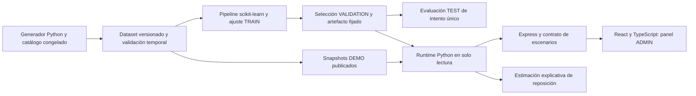

# Informe técnico del modelo predictivo H4

**RepuestoPro · Ingeniería de Sistemas · Release oficial 4.0.0**

## 1. Introducción

El catálogo de repuestos reúne productos de rotación desigual. Las ventas mensuales por tienda varían con la disponibilidad, el historial reciente y los compromisos conocidos. RepuestoPro incorpora una estimación cuantitativa para comparar hipótesis antes de revisar necesidades de inventario. Una previsión útil debe conservar el origen de sus entradas y reconocer cuándo el historial o el dominio del modelo impiden emitirla.

## 2. Objetivo del modelo predictivo

Se estiman las **unidades de venta observadas en el simulador para un producto y una tienda durante el siguiente mes**, a partir de un corte al inicio de ese mes en America/La_Paz. Las ventas realizadas dependen del suministro. La demanda no satisfecha queda fuera del objetivo. En H4, la predicción y la reposición sirven como apoyo académico para comparar hipótesis. Las cantidades sugeridas no crean compras ni movimientos.

## 3. Arquitectura del módulo

Python genera tablas de escenarios y valida sus relaciones. pandas construye la matriz y scikit-learn ajusta el pipeline. joblib conserva el estimador y su preprocesamiento. Node.js con Express y TypeScript autoriza la sesión y ejecuta el adaptador Python por entrada y salida estándar. React, Vite y TypeScript presentan historial, comparación, impactos, advertencias y exportación. La API usa el control de acceso de la aplicación. Las características predictivas provienen de los snapshots publicados y la consulta de escenarios conserva intacto el inventario comercial. Streamlit se utiliza en un comparador local separado.

## 4. Dataset

El build `calendar-20261116-01` usa un catálogo congelado de **56 productos y tres tiendas** (ubicaciones 5, 6 y 7), con **168 pares**. La simulación usa realizaciones diferenciadas, semilla 42 y tablas para historial, precios, cotización, costo, stock al corte, pedidos, entregas previstas y realizadas, resultados mensuales y libro diario. Los supuestos de sensibilidad económica proceden del diseño sintético. El conjunto Automotive se excluyó por licencia pendiente.

| Bloque 4.0.0 | Meses objetivo | Filas supervisadas | Uso |
| --- | --- | ---: | --- |
| Calentamiento | Nov 2024–ene 2025 | — | Historia para los primeros rezagos |
| TRAIN | Feb 2025–abr 2026 | 5.040 | Ajuste y diagnóstico temporal interno |
| VALIDATION | May–jul 2026 | 1.008 | Selección oficial y referencia de desarrollo |
| TEST | Ago–oct 2026 | 1.008 | Evaluación final congelada |
| DEMO | Feb 2025–oct 2026 | 7.056 | Realización independiente de la selección |
| **Total supervisado** | | **14.112** | |

La base DEMO que se exhibe abarca enero a octubre de 2026. Los 168 snapshots de **noviembre de 2026** son entradas de inferencia sin etiqueta observada. Los tamaños y métricas de 4.0.0 se distinguen de la línea histórica V1 con dataset 1.1, del replay 2.2.0 de cinco entradas y del build de escenarios 3.0.0. Los experimentos 4.1.0 y 4.1.1 utilizaron particiones de desarrollo de 4.0.0. La documentación histórica de cada release conserva sus propios denominadores. [Manifiesto y partición 4.0.0](../../ml/demand/data/repuestopro_v2/4.0.0/calendar-20261116-01/manifest.json) · [Guía H4](H4_IMPLEMENTACION_MODELO_PREDICTIVO.md)

## 5. Preparación de datos

La limpieza del build consiste en controles de estructura, dominios, duplicados, coherencia entre tablas y completitud. El validador cruza producto, tienda, escenario, fechas y resultados cerrados. Los rezagos son las ventas observadas de los tres meses exactos anteriores al objetivo, con cada dato disponible al corte. Los cambios hipotéticos se identifican como planes. Las realizaciones, cantidades realizadas, stock posterior al corte y demanda latente quedan fuera de las entradas de ajuste.

| Grupo | Entradas de 4.0.0 |
| --- | --- |
| Historia | Ventas en t−1, t−2 y t−3, proporción mayorista en t−1 y días sin stock en t−1 |
| Calendario | Seno y coseno del mes |
| Precios | Minorista y mayorista BASE al corte, dos variaciones ponderadas y días de vigencia |
| Inventario y compromisos | Stock vendible al corte, reservas posteriores y compromisos minoristas y mayoristas dentro del horizonte |
| Recepciones previstas | Unidades elegibles y días hasta la primera entrada |
| Catálogo | Categoría del producto |

El transformador aplica imputación mediana con indicador de faltante al grupo numérico y codificación one-hot con manejo de categoría desconocida. LinearRegression utiliza además escalado numérico ajustado en TRAIN. El runtime exige referencias coherentes. Si la serie carece de snapshot válido o de historia utilizable, el sistema impide tratar el faltante como venta cero. [Validador](../../ml/demand/v2/validate_scenarios_v1.py) · [Esquema de características](../../ml/demand/v2/scenario_data.py)

## 6. Algoritmos investigados

La selección 4.0.0 comparó Lag1, LinearRegression y dos bosques. Lag1 copia las ventas del mes anterior y ofrece una referencia fácil de auditar. Random Forest representa relaciones no lineales con información tabular. Se eligió por **menor MAE de VALIDATION**, con RMSE como segundo criterio. El bosque cuadrático obtuvo menor RMSE que el bosque absoluto, con mayor MAE.

| Método en VALIDATION, 1.008 filas | MAE | RMSE | R² |
| --- | ---: | ---: | ---: |
| Lag1 | 19.4067 | 36.0517 | −0.2923 |
| LinearRegression | 15.7254 | 25.0511 | 0.3760 |
| Bosque cuadrático | 12.4399 | 19.9870 | 0.6028 |
| Bosque absoluto | **11.5168** | 20.3483 | 0.5883 |

M41-04 implementó además media móvil, SBA, TSB y estacional ingenuo como métodos offline con historia verificada. La selección oficial solo utilizó Lag1 como baseline. Los experimentos posteriores incorporaron media móvil de tres meses. [Resultados de selección](../../ml/demand/reports/v2/4.0.0/calendar-model-20261116-01/experiments.csv) · [Baselines M41-04](H4_M41_04_BASELINES_OFFLINE.md)

## 7. Entrenamiento de Random Forest 4.0.0

La configuración congelada es `RandomForestRegressor` con 100 árboles, criterio `absolute_error`, profundidad máxima 14, mínimo 4 por hoja, `max_features=0.9`, semilla 42 y dos trabajadores. Cada familia aporta peso total uno al ajuste para controlar el efecto de sus variantes emparejadas. Las 5.040 filas TRAIN alimentaron el ajuste y las 1.008 filas VALIDATION guiaron la selección. El artefacto incluye las transformaciones y el estimador.

- Identificador: `calendar-model-20261116-01`.
- Artefacto: `ml/demand/models/v2/calendar-model-20261116-01/model.joblib`.
- SHA256: `8d73bbfb769e432461f2a202e37842b47820a76627e46be3e4ba412e64562e1e`.
- Entorno declarado del release: Python 3.11.9 y scikit-learn 1.9.1.

El manifiesto fija orden de características, cotas TRAIN, hashes, versión de política y periodo. El código histórico rechaza sobrescribir un build o release existente. La reproducibilidad de este informe consiste en enlazar el protocolo y la evidencia congelada. [Entrenamiento](../../ml/demand/v2/calendar2026.py) · [Release](../../ml/demand/reports/v2/4.0.0/calendar-model-20261116-01/release.json) · [Selección](../../ml/demand/reports/v2/4.0.0/calendar-model-20261116-01/selection.json)

## 8. Evaluación oficial

El registro de intento único precede a los resultados TEST. TRAIN cuenta con tres diagnósticos internos expansivos, con MAE del bosque de 10.9108, 12.4739 y 12.0218. VALIDATION decidió el estimador. TEST permaneció sellado hasta fijar el release. DEMO permite revisar comportamiento del runtime.

| TEST guardado, 1.008 filas | MAE | RMSE | R² |
| --- | ---: | ---: | ---: |
| Random Forest 4.0.0 | **10.2010** | **18.4046** | **0.6201** |
| Lag1 | 17.3581 | 33.0549 | −0.2256 |

El MAE mide el tamaño medio del error absoluto en unidades. El RMSE da mayor peso a los errores grandes. R² compara el error cuadrático con la variación de los observados respecto a su media. Puede ser negativo y carece de interpretación como porcentaje de aciertos. La reducción relativa del **MAE** frente a Lag1 fue aproximadamente **41.23 %** en este TEST sintético.

Las métricas agregadas anteriores usan **1.008 filas**. La política de servicio habría emitido en **1.002/1.008 (99.40 %)**, con seis abstenciones. En noviembre DEMO hubo **136/168 (80.95 %)** respuestas numéricas y 32 abstenciones por stock superior al máximo TRAIN de 150 unidades. Cobertura significa disponibilidad de pronóstico. Los registros revisados carecen de un intervalo predictivo con cobertura del 95 % calibrada y de pares individuales completos para calcular porcentajes de acierto.

El MAE del bosque fue menor que Lag1 en **50 de 56** productos del reporte guardado. Entre los mayores MAE del bosque se encuentran los IDs 12 (26.1200), 56 (22.9622), 40 (21.3422) y 29 (21.2231). En los IDs 13 y 46 el bosque fue inferior a Lag1 según MAE. Por tienda, el bosque obtuvo 10.0510, 10.5404 y 10.0116 en ubicaciones 5, 6 y 7. Estos resultados por grupo describen una muestra sintética y no fundamentan cambios de producto tras TEST. [Evaluación guardada](../../ml/demand/reports/v2/4.0.0/calendar-model-20261116-01/test-evaluation.json) · [Cobertura DEMO](../../ml/demand/reports/v2/4.0.0/calendar-model-20261116-01/november-inference-review.json)

## 9. Integración al sistema

1. Un usuario ADMIN solicita capacidades y selecciona producto, tienda y mes. Express consulta el runtime y obtiene un snapshot publicado que fija identidad, corte y estado BASE.
2. El panel envía el snapshot y una hipótesis al endpoint de preview. El contrato `demand-scenarios-1.0.0` valida esquema, fechas, cantidades, coherencia de precio y costo y correspondencia del snapshot.
3. Python verifica integridad del release, prepara las características y evalúa BASE e hipótesis. Si hay abstención, las unidades se publican nulas con motivo. El cálculo estadístico y el cálculo de reposición son independientes: la reposición considera requeridas, stock, entradas elegibles y reservas posteriores. Su alcance mensual no garantiza disponibilidad diaria.
4. React valida la respuesta, presenta diferencias, impactos, advertencias y reposición, y exporta un JSON de evidencia. Una hipótesis idempotente devuelve su respuesta guardada. Reutilizar su clave con otro cuerpo devuelve 409. La clave es por actor y petición.
5. M41-06 preserva las características de BASE ante precios económicamente idénticos y elimina advertencias numéricas residuales cuando el pronóstico publicado es nulo. M41-08 expone `computed` o `replayed` y la revisión del runtime por cabeceras. La exportación conserva fecha original, huella de entrada y procedencia. Si esta falta, se muestra como desconocida.

[Runtime](../../ml/demand/v2/scenario_runtime.py) · [Ruta Express](../../backend/src/modules/predictions/predictions.routes.ts) · [Panel](../../frontend/src/components/DemandScenarioPanel.tsx) · [M41-06](H4_M41_06_CORRECCIONES_RUNTIME.md) · [M41-08](H4_M41_08_TRAZABILIDAD_RESPUESTAS.md)

## 10. Experimentos 4.1.0

Cuatro candidatos se ajustaron con TRAIN y se compararon en las mismas 1.008 filas de VALIDATION histórica. La referencia congelada obtuvo MAE 11.5168. Hist y RF alternativo redujeron RMSE, pero cada candidato aumentó el MAE.

| Candidato | MAE | RMSE | R² |
| --- | ---: | ---: | ---: |
| RF alternativo | 12.5748 | 20.1848 | 0.5949 |
| HistGradientBoosting | 12.5731 | 20.0659 | 0.5997 |
| Hurdle de ocurrencia y magnitud | 12.8323 | 20.5904 | 0.5785 |
| Híbrido Hist y Lag1 | 13.1990 | 21.6529 | 0.5338 |

Lag1 obtuvo MAE 19.4067 y MA3 17.2216. En la máscara común del dominio quedaron 995/1.008 filas y el bosque oficial conservó el menor MAE. La VALIDATION reutilizada carece de independencia respecto a la selección histórica. Los cuatro artefactos quedaron experimentales. [Informe 4.1.0](../../ml/demand/experiments/model_4_1_0/reports/COMPARACION_EXPERIMENTAL.md)

## 11. Experimentos 4.1.1

Los prefijos expansivos usaron exclusivamente TRAIN. Se ajustó hasta julio de 2025, octubre de 2025 y enero de 2026, con evaluación en los tres meses siguientes a cada corte y 1.008 filas por fold. C y D agregaron media, desviación estándar poblacional y fracción de ceros de los tres rezagos. B y D limitaron profundidad a 11 y elevaron el mínimo por hoja a 8.

| Variante | MAE F1 | MAE F2 | MAE F3 | MAE medio | RMSE agrupado |
| --- | ---: | ---: | ---: | ---: | ---: |
| A · Configuración oficial ajustada por prefijo | 10.9108 | 12.4739 | 12.0218 | 11.8022 | 21.6519 |
| B · Regularización | 10.7121 | 12.8126 | 12.0819 | 11.8688 | 22.7888 |
| C · Rezagos derivados | 10.8035 | 12.5176 | 11.6728 | 11.6646 | 21.8288 |
| D · Derivadas y regularización | 10.7771 | 12.5046 | 11.6860 | 11.6559 | 22.7130 |

D mejoró el MAE en dos folds y en 32 de 56 productos. Mejoró en las tres tiendas, con margen mínimo en la ubicación 6 (11.5459 → 11.5412). En referencias con ceros y positivos en la historia, el MAE pasó de 12.6102 a 12.2859. En alta variabilidad empeoró de 18.1194 a 18.1928. El RMSE y la dispersión entre folds aumentaron. La puerta de rango por prefijo dejó dos folds sin cobertura por calendario y cubrió 1.004/1.008 filas del tercero.

La reducción descriptiva de MAE (1.24 %) permitió seleccionar D para conservarlo como candidato experimental. El reajuste final con todo TRAIN carece de evaluación independiente. **C tiene métricas por fold y carece de artefacto persistido.** [Informe 4.1.1](../../ml/demand/experiments/model_4_1_1/reports/COMPARACION_TEMPORAL.md)

## 12. Comparador experimental

El cargador comprueba SHA256, versión, columnas y preprocesamiento de 4.0.0 y D. El adaptador proyecta el mismo snapshot DEMO en las 19 entradas oficiales y agrega los tres resúmenes de rezagos para D. Usa una puerta común de elegibilidad. CLI y Streamlit llaman a la misma función de inferencia. La interfaz exhibe selectores, tarjetas, gráfico, tabla, causas de abstención e identificadores y huellas. C permanece visible como indisponible.

En **Tensador de Correa, Tienda 2, noviembre de 2026**, 4.0.0 predice **87.17** y D **80.02** unidades. La diferencia con signo es **−7.15 unidades (−8.20 %)** y la absoluta es 7.15. El snapshot carece de ventas observadas autorizadas para determinar cuál se aproximó más. [Comparador y reproducción](../../ml/demand/experiments/model_4_1_1/comparator/README.md)

## 13. Validación y pruebas

| Evidencia | Alcance y resultado |
| --- | --- |
| Integración histórica del release | 507 pruebas distintas en el registro de 4.0.0: 294 frontend, 184 backend, 27 Python y 2 de integridad. Ambos builds aprobados. |
| M41-06 y M41-08 | M41-06 registró 84 pruebas focalizadas y 36 casos y subcasos HTTP. M41-08 registró 37 HTTP, incluidos casos ya existentes. Los conteos corresponden a ejecuciones distintas. |
| Modelos experimentales | Cuatro artefactos de 4.1.0 recargados con MAE reproducido. En 4.1.1 se verificaron fechas, familias, fórmulas, métricas y carga del candidato D. |
| Comparador | Siete pruebas focalizadas de lectura, adaptador, inferencia, integridad e interfaz Streamlit mediante AppTest. |
| H4-J02 y J02B | Recorrido técnico en Chrome con Express, Python y PostgreSQL local en solo lectura. J02B verificó 18 subcasos, incluidos roles, demora, logística y procedencia. Sigue pendiente la aceptación personal de Erika y Ross y un caso autorizado de producto registrado sin historia. |

En esta revisión documental se ejecutaron las siete pruebas del comparador con el nuevo diseño. AppTest comprobó las tarjetas del caso de exposición y el cambio a un snapshot con abstención. Se constató la igualdad de huellas de los 554 archivos del inventario protegido de inicio y la concordancia de los cinco artefactos experimentales con sus registros. Las cifras oficiales de la tabla proceden del reporte guardado.

[Registro histórico de integración](../../ml/demand/reports/v2/4.0.0/calendar-model-20261116-01/integration-review.json) · [J02B y evidencias](H4_J02B_CONTINUACION_ACEPTACION.md)

## 14. Limitaciones

El generador sintético facilita controlar escenarios y no certifica comportamiento comercial. Las ventas pueden quedar censuradas por inventario. La intermitencia observada puede combinar ceros genuinos con quiebres. Los productos con mayor error requieren más evidencia propia. La puerta de rango reduce exposición a entradas nuevas a cambio de abstenciones. Las dos variantes por familia comparten historia y los tres folds de 4.1.1 no proporcionan una réplica externa. La elección entre experimentos sobre datos de desarrollo también introduce riesgo de sobreajuste. M41-03 documenta los requisitos de adquisición y separación temporal de una futura cohorte. [Ficha de cohortes](H4_M41_03_FICHA_COHORTES.md)

## 15. Resultados y conclusiones

- **Oficial.** El release fijo mejora respecto a Lag1 en TEST sintético y sostiene un flujo de escenarios trazable con abstenciones.
- **Experimental.** 4.1.0 no mejoró MAE frente al release. D redujo modestamente MAE interno de 4.1.1, con degradación en RMSE y alta variabilidad. Se conserva como candidato sin activar.
- **Aporte técnico.** Separación entre estimador, reglas de reposición y evidencia de ejecución, con controles temporales, trazabilidad de hipótesis y recuperación idempotente.
- **Trabajo futuro.** Obtener observados cerrados e información disponible al corte de una cohorte independiente autorizada. Fijar comparación pareada y monitorear por producto, tienda y disponibilidad. Calibrar intervalos solo con una reserva independiente apropiada. Completar el recorrido conjunto de aceptación.

## 16. Trazabilidad de evidencias

| Afirmación | Archivo fuente | Métrica o evidencia | Estado de verificación |
| --- | --- | --- | --- |
| Dataset, realizaciones y meses de 4.0.0 | [Manifiesto](../../ml/demand/data/repuestopro_v2/4.0.0/calendar-20261116-01/manifest.json), [split](../../ml/demand/data/repuestopro_v2/4.0.0/calendar-20261116-01/split_manifest.json) | 14.112 filas y cuatro realizaciones | Implementado, verificado por manifiestos |
| Bosque absoluto seleccionado antes de TEST | [Release](../../ml/demand/reports/v2/4.0.0/calendar-model-20261116-01/release.json), [selección](../../ml/demand/reports/v2/4.0.0/calendar-model-20261116-01/selection.json) | MAE 11.5168 en VALIDATION y hash fijo | Entrenado, seleccionado y congelado |
| Evaluación oficial y desglose por producto | [TEST](../../ml/demand/reports/v2/4.0.0/calendar-model-20261116-01/test-evaluation.json), [intento único](../../ml/demand/reports/v2/4.0.0/calendar-model-20261116-01/final-test-attempt.json) | MAE 10.2010, RMSE 18.4046, R² 0.6201 | Evaluado históricamente una vez; verificado por lectura |
| API, trazabilidad y panel | [J02B](H4_J02B_CONTINUACION_ACEPTACION.md), [M41-08](H4_M41_08_TRAZABILIDAD_RESPUESTAS.md) | HTTP real, exportaciones, roles y caché | Integrado y validado técnicamente en local |
| Aceptación del equipo | [Checklist J02B](H4_J02B_CONTINUACION_ACEPTACION.md) | Conformidad personal sin registro | Pendiente |
| Comparación 4.1.0 | [Resultados](../../ml/demand/experiments/model_4_1_0/evaluation/exploratorio-01.json) | VALIDATION pareada en 1.008 filas | Experimental, evaluado sobre desarrollo |
| Comparación 4.1.1 | [Resultados](../../ml/demand/experiments/model_4_1_1/evaluation/temporal-01.json) | Tres folds TRAIN, D persistido | Experimental, sin activación |
| Ejemplo DEMO | [Informe del comparador](../../ml/demand/experiments/model_4_1_1/comparator/reports/COMPARACION_LOCAL.md) | 87.17 frente a 80.02; observado ausente | Inferencia verificable; exactitud del caso no verificable |
| Confianza del 95 % y nueva generalización | [Ficha de cohortes](H4_M41_03_FICHA_COHORTES.md) | Requiere datos nuevos y calibración temporal | Sin evidencia suficiente |
